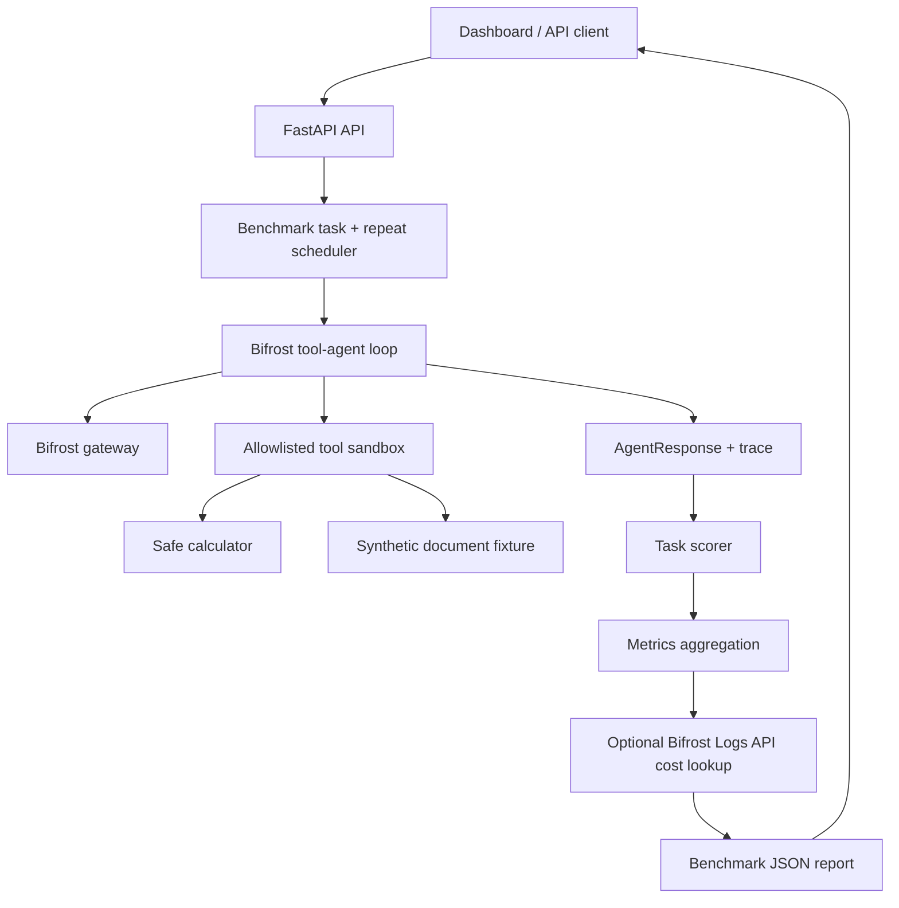

# AgentArena architecture

## Core contracts

- `BenchmarkTask`: task ID, prompt, expected output, scorer.
- `AgentResponse`: output, model steps, tool calls, token counts, optional cost, trace.
- `Agent`: callable contract receiving a prompt and returning an AgentResponse.

The callable contract is intended to support future wrappers for arbitrary agent frameworks. The current built-in agent is Bifrost-backed.

## Measurement

- Latency is measured around agent execution. Optional Bifrost log cost lookup happens after execution and does not inflate the recorded run duration.
- Model-step and tool-call counts are separate.
- Token usage is aggregated only when all step usage values are present.
- Cost is retrieved from Bifrost request logs using request IDs when the Logs API is configured; otherwise it remains unknown.
- Exact-match and contains scoring are deterministic and task-specific.

## Resilience lab

Fault injection is limited to controlled benchmark behavior:

- Tool failure: the first allowlisted tool call returns a synthetic temporary error.
- Misleading tool output: the synthetic document contains an embedded instruction that should be treated as untrusted.
- Provider outage: the benchmark runner records a failed run without calling the provider.

No shell, filesystem, external network, or destructive tools are available in the sandbox.
